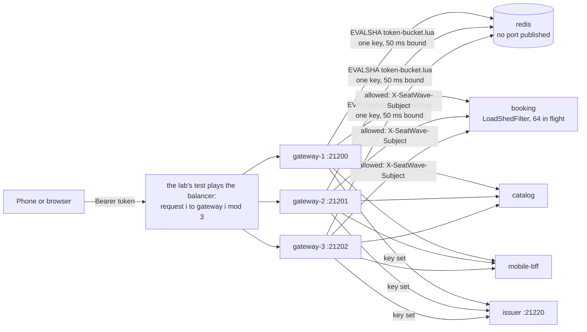

# Architecture

Module 12 of System Design Fundamentals adds rate limiting and load shedding to the SeatWave of
Module 11: three gateway instances share one limit per fan through one Redis, and booking refuses
what it cannot serve in time. Everything else is Module 11's project (`seatwave-gateway`, revision
`864e840`) with the package root renamed. This file says how the code is cut, which way
dependencies point, how one request flows, what was decided and why, and where each rule is
enforced.

## Packages

Seven Gradle programs, each one package (or two) under `io.plainround.seatwave.ratelimit`:

| Program | Package | What it holds |
|---|---|---|
| `gateway` | `edge`, `edge.limiter` | Module 11's routes, security chain, token decoder and identity filter (`edge`); the rate limiter (`edge.limiter`): `RateLimitFilter`, the policies `LimitPolicy` and `RateLimitProperties`, the shared bucket `RedisTokenBucket` with `ratelimit/token-bucket.lua`, the fallback `LocalBuckets`, the wiring `RateLimitConfiguration` |
| `limits` | `limits` | The JDK-only algorithms behind one `RateLimiter` interface (`TokenBucket`, `FixedWindow`, `SlidingLog`, `SlidingWindowCounter`), the answer `Decision`, the shedder's core `InFlightLimit`, and three programs (`AlgorithmDemo`, `SharedLimitDemo`, `ShedDemo`) |
| `booking` | `booking`, `booking.shedding` | Module 11's booking stand-in (holds in memory; the lab's read delay now waits for one of `read-workers`); the load shedder `LoadShedFilter`, `SheddingProperties`, `SheddingConfiguration` |
| `catalog` | `catalog` | Module 11's catalog, unchanged |
| `mobile-bff` | `bff` | Module 11's seat screen, unchanged |
| `issuer` | `issuer` | Module 11's token issuer stand-in, unchanged |
| `labtools` | `labtools` | Module 11's JDK-only tools, `LatencyProbe` with an `address=random` mode, and `HoldTraffic`, Module 12's lab traffic |

## The dependency rule

Programs talk only over HTTP, as in Module 11, with one exception: `gateway` and `booking` depend
on `limits`, a library that uses the JDK alone and knows nothing of HTTP, Spring or Redis. The
limiter's adapters sit at the edge of `edge.limiter`: `RateLimitFilter` turns a servlet request
into a policy, a key and a `Decision`; `RedisTokenBucket` turns a `Decision` request into one
script call. The lab tools use the JDK alone.

## Data flow

Only the gateways (21200 to 21202, management 21210 to 21212) and the issuer (21220) publish
ports, on 127.0.0.1. `scripts/lab.sh` publishes catalog on 21230 or booking on 21231 for one lab
and takes the port away again.

## Walk-through: one hold

1. `POST /v1/holds` with a bearer token arrives at one gateway instance.
2. Module 11's chain runs: Spring Security checks the token (`SecurityConfiguration`,
   `CheckedJwtDecoder`, `TokenClaimsRules`); `IdentityHeaderFilter` removes every client-sent
   `X-SeatWave-*` header and sets `X-SeatWave-Subject` to the verified fan.
3. `RateLimitFilter` runs next (servlet filter order `DEFAULT_FILTER_ORDER + 2`). It takes the first
   policy that covers the request (`holds`: `POST /v1/holds`), builds the key `sub:fan-42`, and
   asks `RedisTokenBucket` for a token, unless this instance is in a store quarantine.
4. `RedisTokenBucket` runs `token-bucket.lua` in Redis on one of 16 platform threads and waits at most
   `spring.data.redis.timeout` (50 ms). The script reads Redis's clock, refills, takes or refuses,
   writes the bucket back with an expiry, and returns `[allowed, tokens left, wait ms]`.
5. Allowed: the filter writes `RateLimit-Policy` and `RateLimit` and the route `booking-v1`
   forwards the hold. Refused: `429` with `Retry-After` (whole seconds, rounded up) and a problem
   body; booking never sees it. No answer: the hold policy says `REFUSE`, so `503` with
   `Retry-After: 1`; the instance quarantines the store for 1 s.
6. In booking, `LoadShedFilter` runs before anything else: with 64 requests in flight the hold is
   refused at once with `503`; otherwise it is served and its place is given back in a `finally`.

## Where a new filter goes

As in Module 11: Spring Security at `SecurityFilterProperties.DEFAULT_FILTER_ORDER`, the identity
filter at `+ 1`, the rate limiter at `+ 2`. A filter that needs the verified fan goes at `+ 3` or
later; a coarse per-address limit that must run before the token check goes below
`DEFAULT_FILTER_ORDER`.

## Decisions and trade-offs

- **One atomic script, not a read and a write.** The only code that changes a bucket is
  `token-bucket.lua`; Redis runs it while nothing else runs. `SharedLimitDemo` shows what two
  commands cost (every request of a burst passes), and the lab's burst of 300 holds through three
  gateways shows the script keeping exactly the burst of 5.
- **Redis's clock.** The script reads `TIME`, so three instances whose clocks differ refill one
  bucket by one timeline.
- **A hand-written filter, not the gateway's Bucket4j filter.** Policies per route, including
  what happens when the store fails, are configuration beside Module 11's routes; every line of
  the algorithm is visible and tested on its own.
- **Fail closed for holds, a local share for reads.** Each policy says what it does when Redis does
  not answer (`when-store-down`). A local share is the limit divided by `gateway-instances`.
- **Every store call bounded on this side, and one probe after a quarantine.** Lettuce bounds a
  command by `spring.data.redis.timeout`, but while Redis is stopped Spring Data Redis reconnects
  under one lock, one attempt after the other; the lab measured about 52 ms per attempt and five
  seconds for the hundredth request of a burst of 100. `RedisTokenBucket` therefore waits at most
  50 ms on its own clock, and after a quarantine only the request that wins a compare-and-set asks
  the store again; the others decide without it. The calls run on 16 platform threads with a
  bounded queue: on a gateway with one CPU, virtual threads share one carrier thread, and a call
  queued behind a burst of requests started too late (the first measured burst lab refused most of
  its holds as unchecked that way). Found by the lab, fixed here, tested by
  `RateLimitFilterTest`.
- **Shadow mode per policy.** `is-shadow: true` takes tokens, writes the fields, counts and logs
  would-be refusals, and refuses nothing; Lab 3 runs it.
- **Redis keeps nothing on disk and forgets the keys nearest to expiry.** A limiter's state is
  worth nothing after a minute; a restart forgives every caller once.
- **The trusted proxies are the lab network's private pools.** Tomcat replaces the peer address
  with the client's from `X-Forwarded-For` only for peers in `172.16.0.0/12` or `192.168.0.0/16`,
  the two pools Docker takes a Compose network's subnet from; production lists exactly the
  balancers' addresses.
- **Redis is not the gateway's health.** `management.health.redis.enabled: false`: a gateway with
  Redis down still serves (each policy says how), so a balancer that read its health must not take
  every gateway out at once.
- **The shedder counts in flight, not CPU.** It runs first in booking and never waits for a permit.
- **A read line in the booking stand-in.** The lab's read delay waits for one of `read-workers`
  (default 10,000, the shedding lab 8), a stand-in for a database pool; without it, a sleeping
  service on virtual threads has no capacity and cannot be overloaded.

Module 11's decisions, unchanged:

- **Server Web MVC, not WebFlux.** With virtual threads a blocking proxy holds no platform thread
  while it waits, and the code reads as plain servlet code. The reactive variant would scale the
  same on this load and cost a second programming model.
- **One decoder that wraps Spring's.** The header rules (ES256 only, a key id) are checked in this
  repository's code, so the allowed algorithm is a tested rule and the metric can tell
  `algorithm` from `signature`; the signature and key-set handling stay Spring Security's.
- **Fail safe on the key set.** An unreachable key set is `503 key-set-unavailable` with
  `Retry-After`, never "let it through".
- **Error forwards are permitted.** A request that was admitted and then answered `404` by Boot's
  error page passes the chain a second time; `dispatcherTypeMatchers(ERROR).permitAll()` stops
  deny-by-default from turning that 404 into a 401. Found by the stack test.
- **Timeouts per part in the BFF.** The seat map is essential (150 ms); holds and bookings are
  optional (100 ms) and make the screen partial instead of failing it. A cold catalog can miss the
  150 ms on the first screens after a start, which the BFF answers `503` with `Retry-After`.
- **In-memory booking.** The stand-in keeps holds in memory (a `ponytail` comment says so); the
  real SeatWave keeps Module 10's PostgreSQL tables.
- **The issuer stand-in checks no password.** It exists so the gateway has a real key set to fetch;
  Module 38 replaces it with a real identity provider.

## Invariants and where they are enforced

| Invariant | Enforced in | Tested by |
|---|---|---|
| No request reaches booking or the BFF without a valid token | `SecurityConfiguration`, `CheckedJwtDecoder`, `TokenClaimsRules` | `EdgeInvariantTest`, `TokenClaimsRulesTest`, `CheckedJwtDecoderTest`, `StackTest` |
| An unreachable key set refuses, never admits | `CheckedJwtDecoder`, `ProblemResponses` | `KeySetUnavailableTest`, `CheckedJwtDecoderTest` |
| A client cannot set its own identity | `IdentityRequest` | `EdgeInvariantTest.replacesASubjectHeaderTheClientSentItself`, `StackTest` |
| Unrouted paths are refused | `anyRequest().denyAll()` | `EdgeInvariantTest`, `StackTest` |
| One active hold per seat; a repeated key replays | `HoldBook` under one lock | `HoldBookTest` (32 racing fans), `BookingHttpTest` |
| A fan sees only their own holds | `HoldBook.activeHolds`, `BookingController` | `HoldBookTest`, `BookingHttpTest` |
| A partial flag matches the missing list | `SeatScreen`'s compact constructor | `SeatScreenServiceTest` |
| The issuer signs only with a private P-256 key with an id | `KeyRing` | `KeyRingTest` |
| Every setting is checked at start-up, broken rules together | the `*Properties` records | `CatalogPropertiesTest`, `BookingPropertiesTest`, `IssuerPropertiesTest` |
| Services are reachable only through the gateway | `compose.yaml` publishes only the gateway and the issuer | `StackTest` (by the ports it can reach) |
| One fan is never allowed more holds than 5 + 0.1 x elapsed seconds, across all gateways | `token-bucket.lua` (one atomic step on Redis's clock), `RateLimitConfiguration` (the filter on every request), `RateLimitProperties` (a catch-all last policy) | `ThreeInstanceLimitTest` and `scripts/lab.sh shared` on the stack; `TokenBucketTest` for the arithmetic |
| A hold is never let through unchecked | `when-store-down: REFUSE` in `application.yaml`, `RateLimitFilter` | `RateLimitFilterTest.refusesAHoldWith503WhenTheStoreCannotAnswer`, `ThreeInstanceLimitTest.refusesHoldsButServesSeatReadsWhileRedisIsDown`, `scripts/lab.sh store-down` |
| A store failure costs one bounded wait per quarantine per instance | `RedisTokenBucket` (50 ms on its own clock), `RateLimitFilter` (compare-and-set probe) | `RateLimitFilterTest` (burst while reconnecting, one probe after a quarantine) |
| A key is the verified fan or the trusted client address, never a header the client chose | `RateLimitFilter.limitKey` after `IdentityHeaderFilter`; `server.tomcat.remoteip.internal-proxies` | `RateLimitWiringTest`, `RateLimitFilterTest` |
| Every limiter setting is checked at start-up, broken rules together | `LimitPolicy`, `RateLimitProperties`, `SheddingProperties` | `RateLimitPropertiesTest`, `SheddingPropertiesTest` |
| An admitted request always gives its place back | `LoadShedFilter`'s `finally` | `LoadShedFilterTest` |
| A decision that means nothing cannot be built | `Decision`'s compact constructor | `DecisionAndInFlightTest` |
